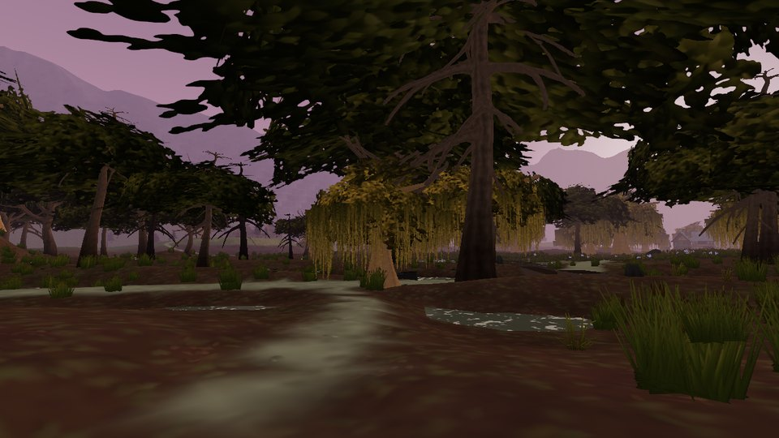
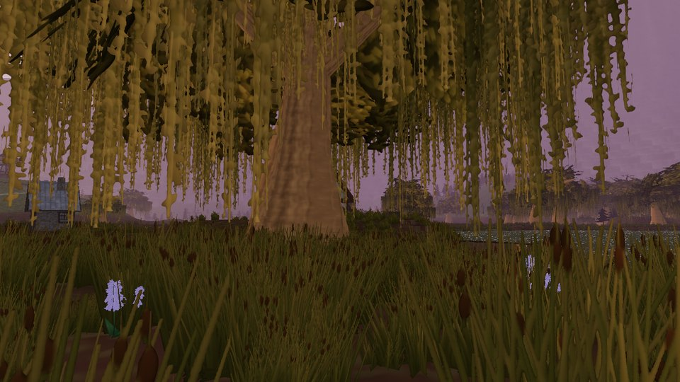
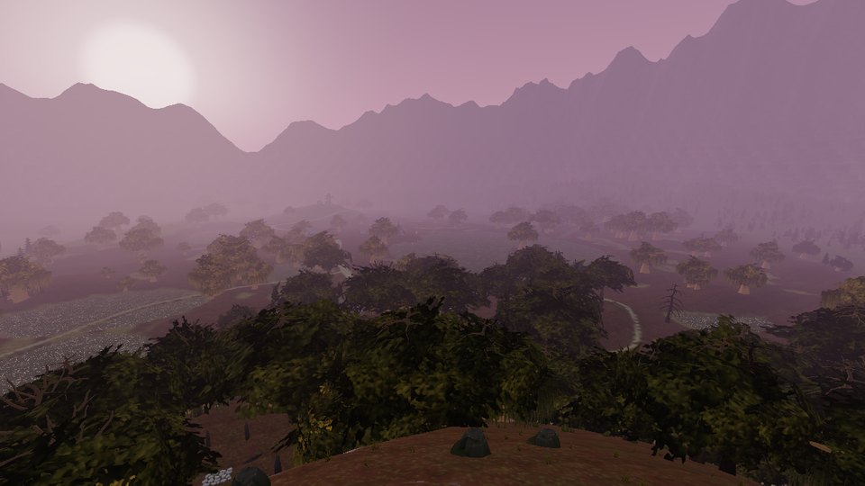

# Godot / Claude Code — Wetlands One-Shot

Specification-driven generation experiment using $250 in Claude Code promotional credits.

Fantasy environment inspired by WoW Classic's Wetlands. Broad terrain, painterly surfaces, exaggerated silhouettes, marshland, settlements, landmarks, atmospheric fog.

**Fallowmere:** drowned upland valley at dusk. Bog water, peat hummocks, moss-covered trees, boardwalk village, ruined hall, cliffside keep.


| | | |
|---|---|---|
|  |  |  |
|  |  |  |

## Build / Run

```sh
dotnet build
godot --path . --editor
godot --path .
```

## References

```sh
tools/fetch-references.sh
```

Approximately 3.1 GB. Pinned in `references/references.yaml`.

- `assets/world/layout.json` — authored environment.
- `docs/WORLD_BIBLE.md` — environment specification.
- `references/README.md` — reference index, provenance, licences.
- `references/visual/` — visual benchmarks.
- `references/godot/candidates/` — implementation research.
- `docs/MCP_COMPARISON.md` — MCP evaluation.
- `docs/WORLD_EDITOR_REFERENCE.md` — editor references.
- `docs/CLASSIC_TERRAIN_NOTES.md` — terrain research.
- `THIRD_PARTY.md` — third-party licences.
- `CLAUDE.md`, `AGENTS.md` — agent instructions.

## Notes

- $250 promotional credits; limited budget, context overhead, no intended platform adoption.
- Throwaway experiment; specification-driven generation rather than conventional development.
- Two one-shot attempts; design specification, context packs, visual references.
- First context pack AI-assembled; extensive references, weak cohesion, semantic anchoring, conflicting visual identity.
- Original specification reasonably coherent; AI-inferred supplementary material obscured intent.
- Second context pack manually curated; corrective response to first attempt.
- Retrieval and aggregation ≠ curation; individually relevant references ≠ coherent design direction.
- Information architecture failure; context quality more consequential than context volume.
- Human interpretability as baseline; incoherent references require substantial creative reconciliation.
- Generated environment recognizable; strong conceptual fidelity despite implementation defects.
- Janky controls, incomplete mechanics, inconsistent execution; neither complete game nor robust technical demonstration.
- Comparable to a student graphics project; substantial result relative to limited resources.
- Implementation unsuitable as production foundation; incremental remediation unlikely to justify continuation.
- Not conventional game development; not production-quality concept art.
- Concept art requires dependable visual consistency; internal deliverables still subject to quality expectations.
- Directional artefact; tangible expression of design intent, atmosphere, composition, conceptual identity.
- Boundary marker; exposes discrepancies between imagined and realized environments.
- Generated artefact becomes reference material; additional context for subsequent specifications.
- Future implementation likely starts fresh; original codebase retained as reference, not foundation.
- Even successful first-pass execution would not necessarily justify retaining the implementation; development process and engineering paradigm matter.
- No demonstrated reduction or redistribution of development effort; activity largely separate from production development.
- Specifications, design documentation, reference curation already necessary; generation adds exploratory capability.
- Value in rapid externalization of ideas; not reusable code or implementation acceleration.
- Specification discovery; generated artefacts clarify intentions, assumptions, omissions, and design boundaries.
- AI-generated references require selective interpretation; accidental decisions risk contaminating subsequent context packs.
- Closer to imagineering than game development; translating mental representations into inspectable environments.
- Imagination imperfectly models realization; generated environments expose discrepancies without requiring production commitment.
- Disposable software; reusable design signals.
