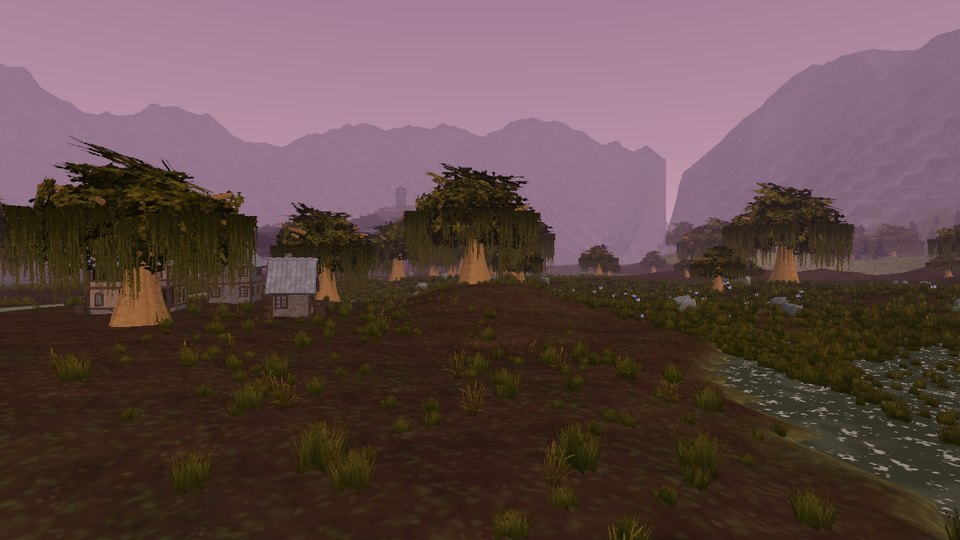
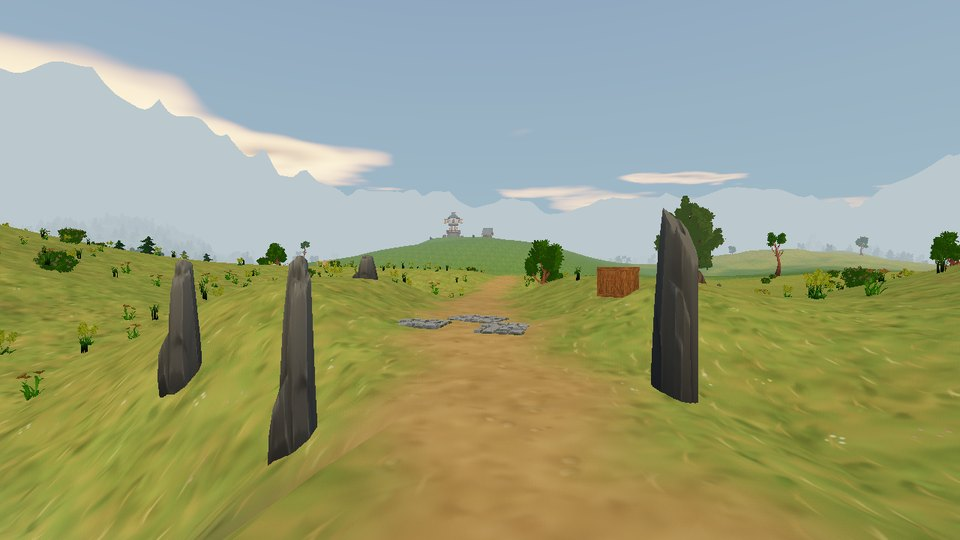
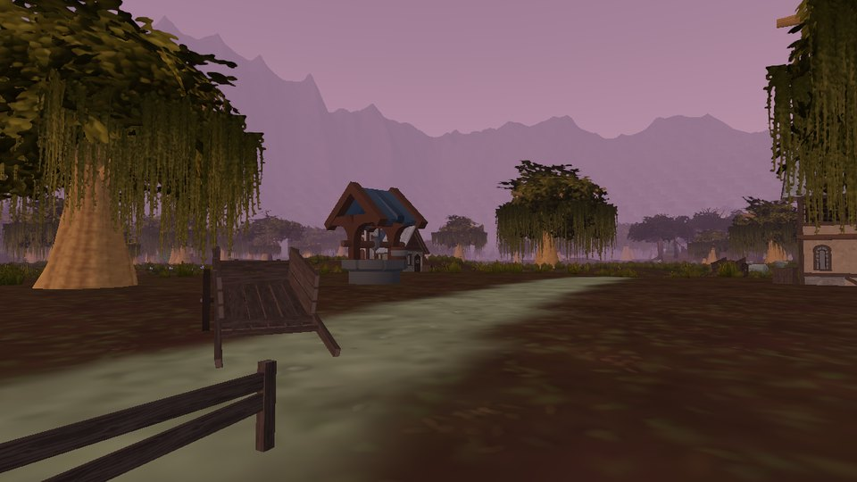
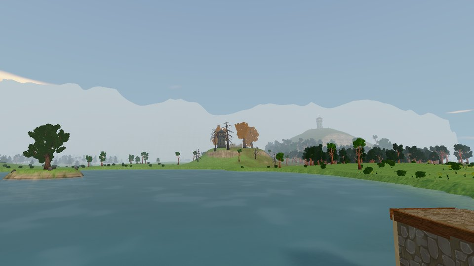
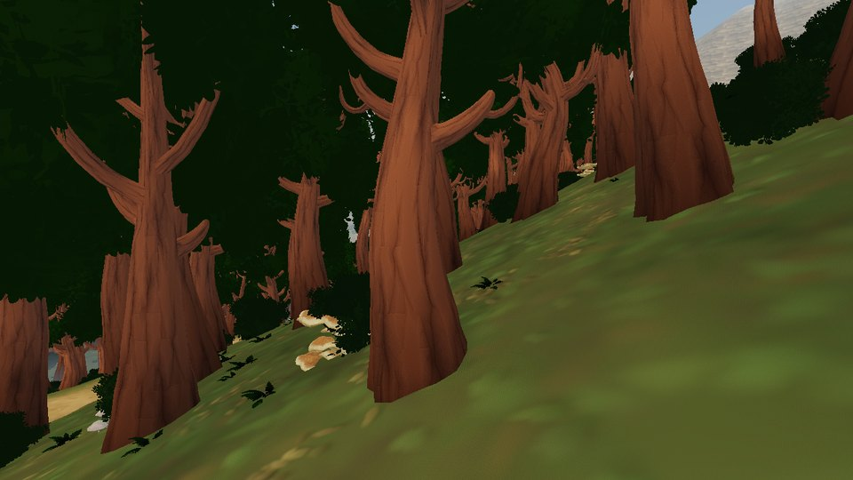
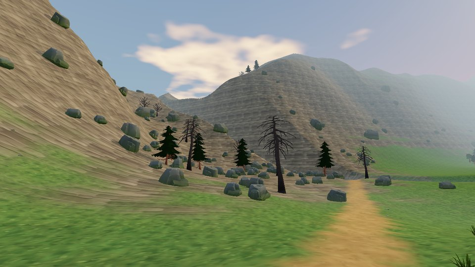

# godot-warcraft-implementation

An original single-player fantasy zone built in Godot 4.5 .NET (C#) that chases the environmental qualities of Vanilla-era MMO worlds: broad readable terrain, painterly low-detail surfaces, bold silhouettes, a committed palette, memorable roads, villages, water and landmarks, and fog as a design tool. The world is generated at startup from one authored layout file (`assets/world/layout.json`) by small project-specific C# systems; see `docs/WORLD_BIBLE.md` for the zone itself.



| | | |
|---|---|---|
|  |  |  |
|  |  |  |

More in `docs/screenshots/` (rendered with `tools/screenshot.sh`, software Vulkan, so a GPU will look crisper).

## Requirements
- [Godot 4.5.x **.NET/Mono** build](https://godotengine.org/download) (4.5+ is needed by the Terrain3D candidate)
- .NET SDK 8

## Build & run
```sh
dotnet build                                   # builds GodotWarcraft.sln/.csproj
godot --path . --editor                        # open in the editor (use the .NET build)
godot --path .                                 # run scenes/Main.tscn and wander the zone
GODOT=/path/to/godot tools/run.sh              # build + headless smoke test (prints "Main ready")
GODOT=/path/to/godot tools/screenshot.sh       # render the hero shots to screenshots/ (Xvfb + Mesa lavapipe; no GPU needed)
tools/validate_layout.py                       # sanity-check assets/world/layout.json before running
```
`tools/screenshot.sh [shotA,shotB]` renders the shots listed in the layout. `EXTRA="--nofog --noshadow"` and `EXTRA="--debug-draw=unshaded"` help diagnose rendering; `LAYOUT=res://assets/world/other.json` renders a different layout.

## Walking the zone
Run `godot --path .` and you spawn at Pilgrim's Gap as a hooded wanderer. WoW-style controls: W/S walk along the camera, A/D strafe, Q/E turn, Shift run, right-drag steers the camera and character, left-drag orbits only, wheel zooms (2-14 m), F toggles a free fly camera, Escape releases the mouse. Follow the road east: windmill, saddle reveal, Thistlebury, the Fallen Span, Hollin Wood, the coil up Candlehill.

## How the world is built
`src/World/WorldRoot.cs` loads the layout and runs, in order: `TerrainBuilder` (heightfield from authored hills/ridges/basins/lake/rivers/roads/flats, plus five ground layers and a baked hue tint) → `TerrainMesh` (chunked meshes + heightmap collider, `shaders/terrain.gdshader`) → `WaterBuilder` (lake disc and river ribbons, `shaders/water.gdshader`) → `SiteBuilder` (cottages assembled from the modular kit by `CottageBuilder`, KayKit landmarks with a muted palette, fences, ruins, standing stones, fields; marks ground as claimed) → `FoliagePlacer` (clumped tree stands with glades, undergrowth, rocks and verge pebbles via MultiMesh, `shaders/foliage.gdshader` wind). `Atmosphere` sets the painted sky (`shaders/sky.gdshader`), one soft sun and horizon-matched depth fog. Ground tiles are painted procedurally by `tools/paint_textures.py`; the KayKit palette is muted by `tools/retint_kaykit.py`. Everything reads coordinates as metres from the map centre, X east, Z south, Y up.

## Reference library
```sh
tools/fetch-references.sh        # one command; pinned in references/references.yaml (~3.1 GB)
```
Then read `references/README.md` (index: what, why, licence, key files). Visual benchmarks live in `references/visual/` and topic catalogues in `references/godot/candidates/` (committed, no fetch needed). Licences: `THIRD_PARTY.md`.

## Layout
`scenes/` `src/` (C#: `World/`, `Player/`, `Tools/`) `shaders/` `assets/` (`world/layout.json`, `textures/ground/`, `third_party/` CC0 kits) `addons/` `tools/` `references/` `docs/` · agent guidance: `CLAUDE.md`, `AGENTS.md`
Docs: `docs/WORLD_BIBLE.md` (the zone), `docs/MCP_COMPARISON.md`, `docs/WORLD_EDITOR_REFERENCE.md`, `docs/CLASSIC_TERRAIN_NOTES.md`
