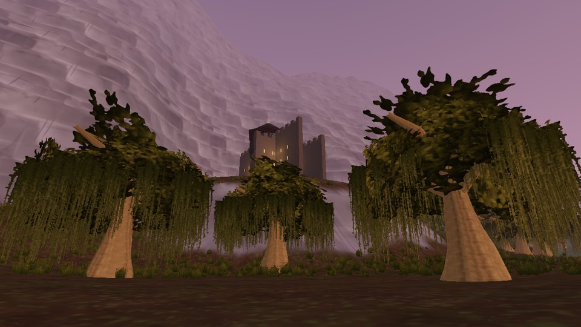
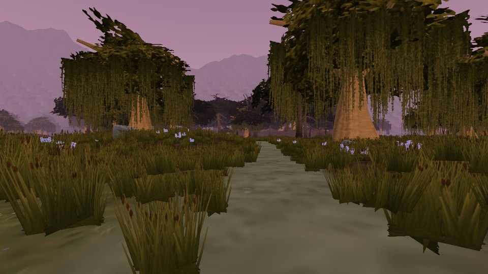
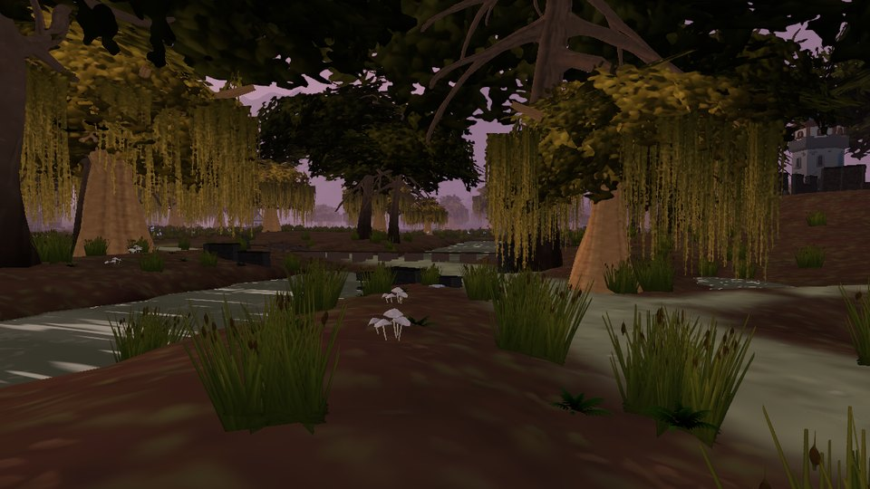

# godot-warcraft-implementation

An original single-player fantasy zone built in Godot 4.5 .NET (C#) that chases the environmental qualities of Vanilla-era MMO worlds: broad readable terrain, painterly low-detail surfaces, bold silhouettes, a committed palette, memorable roads, villages, water and landmarks, and fog as a design tool. The zone, Fallowmere, is a drowned upland vale at dusk in the register of WoW Classic's Wetlands: one sheet of bog water broken into named pools and peat hummocks, weeping moss trees and giant dark bog oaks standing in the shallows, reeds on every bank, a village on boardwalks, a ruined hall, a lit keep on a cliff ledge, and lavender fog that takes the far shore within a few hundred metres. The world is generated at startup from one authored layout file (`assets/world/layout.json`) by small project-specific C# systems; see `docs/WORLD_BIBLE.md` for the zone itself and `references/visual/wow-classic/*.jpg` for the three frames it is tuned against.


| | | |
|---|---|---|
|  |  |  |
|  |  |  |

More in `docs/screenshots/` (curated from a `screenshots/<run>/` render with `tools/curate_screenshots.py`; rendered with `tools/screenshot.sh`, software Vulkan, so a GPU will look crisper).

## Requirements
- [Godot 4.5.x **.NET/Mono** build](https://godotengine.org/download) (4.5+ is needed by the Terrain3D candidate)
- .NET SDK 8

## Build & run
```sh
dotnet build                                   # builds GodotWarcraft.sln/.csproj
godot --path . --editor                        # open in the editor (use the .NET build)
godot --path .                                 # run scenes/Main.tscn and wander the zone
GODOT=/path/to/godot tools/run.sh              # build + headless smoke test (prints "Main ready")
GODOT=/path/to/godot tools/screenshot.sh       # render the hero shots to screenshots/ (Xvfb + Mesa lavapipe; no GPU needed)
tools/validate_layout.py                       # sanity-check assets/world/layout.json before running
```
`tools/screenshot.sh [shotA,shotB]` renders the shots listed in the layout. `EXTRA="--nofog --noshadow"` and `EXTRA="--debug-draw=unshaded"` help diagnose rendering; `LAYOUT=res://assets/world/other.json` renders a different layout; `EXTRA="--palette=res://assets/world/palette_night.json" OUT=screenshots/night` applies the night mood overlay (palette, sun and fog only). `tools/shot_stats.py screenshots/<run>/*.png` prints luminance percentiles per shot to check the value structure, and `tools/curate_screenshots.py screenshots/<run> docs/screenshots` refreshes the pictures above.

## Walking the zone
Run `godot --path .` and you spawn at Pilgrim's Gap as a hooded wanderer. WoW-style controls: W/S walk along the camera, A/D strafe, Q/E turn, Shift run, right-drag steers the camera and character, left-drag orbits only, wheel zooms (2-14 m), F toggles a free fly camera, Escape releases the mouse. Follow the road east: the windmill on Hob's Rise, the saddle reveal of the drowned Mere, Thistlebury and its boardwalk Hythe, the reed road to Thistle Cross, the causeway and boardwalk at the Fallen Span, Hollin Wood and the Nine Sisters, the coil up Candlehill to the Candle; from the fork below it the Keep Stair climbs the east rim to Greywatch, the lit keep.

## How the world is built
`src/World/WorldRoot.cs` loads the layout (optionally merging a `--palette=` mood overlay over its palette, sun and fog) and runs, in order: `TerrainBuilder` (heightfield from authored hills/ridges/basins/flats, then the marsh: ground pulled to a floor just above the water sheet, a field of flat-topped peat hummocks and carved pools; the old lake bowl, river trenches, roads flattened and clamped above the sheet as causeways; five painted ground layers with marsh splat rules for peat, a sedge ring at the waterline and turf on the hummock crowns, plus a baked hue tint and a pale-wall layer on the high rim) → `TerrainMesh` (chunked meshes + heightmap collider, `shaders/terrain.gdshader`) → `WaterBuilder` (one marsh sheet as a clipped grid plus river ribbons, murky bog water with painted glints, `shaders/water.gdshader`) → `SiteBuilder` (cottages assembled from the modular kit by `CottageBuilder`, KayKit landmarks with a muted grey tint, fences, ruined and intact walls, standing stones, boardwalks on posts, lit window rows, braziers, hand-placed hero trees; marks ground as claimed) → `FoliagePlacer` (clumped tree stands that gather on hummock crowns, wader trees in the shallows, reed rings at the water's edge, undergrowth, rocks and verge pebbles via MultiMesh, `shaders/foliage.gdshader` wind). `ProceduralFoliage` builds the moss trees, bog oaks and reed clumps as meshes by name; `Atmosphere` sets the painted sky with a low sun disc and optional star field (`shaders/sky.gdshader`), the ambient, the shadowless dusk sun, horizon-matched depth fog and a height-fog haze on the water, all from the layout's `sun` and `fog` blocks. Ground tiles are painted procedurally by `tools/paint_textures.py` and the foliage cards (moss curtains, leaf clumps, reeds, pale bark) by `tools/paint_foliage.py`; the KayKit palette is muted by `tools/retint_kaykit.py`; `tools/shot_stats.py` measures rendered shots. Everything reads coordinates as metres from the map centre, X east, Z south, Y up.

## Reference library
```sh
tools/fetch-references.sh        # one command; pinned in references/references.yaml (~3.1 GB)
```
Then read `references/README.md` (index: what, why, licence, key files). Visual benchmarks live in `references/visual/` and topic catalogues in `references/godot/candidates/` (committed, no fetch needed). Licences: `THIRD_PARTY.md`.

## Layout
`scenes/` `src/` (C#: `World/`, `Player/`, `Tools/`) `shaders/` `assets/` (`world/layout.json`, `world/palette_night.json`, `textures/ground/`, `textures/foliage/`, `third_party/` CC0 kits) `addons/` `tools/` `references/` `docs/` · agent guidance: `CLAUDE.md`, `AGENTS.md`
Docs: `docs/WORLD_BIBLE.md` (the zone), `docs/MCP_COMPARISON.md`, `docs/WORLD_EDITOR_REFERENCE.md`, `docs/CLASSIC_TERRAIN_NOTES.md`
