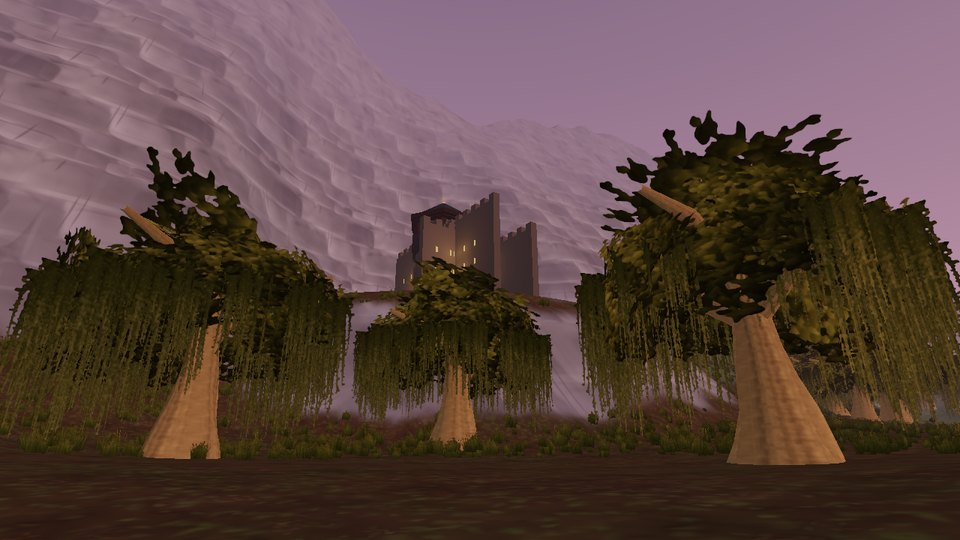
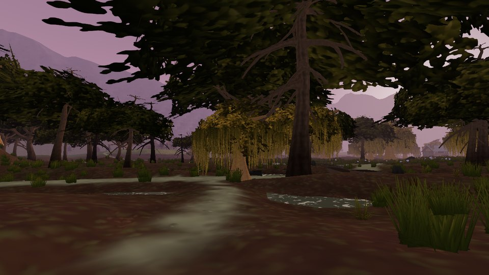
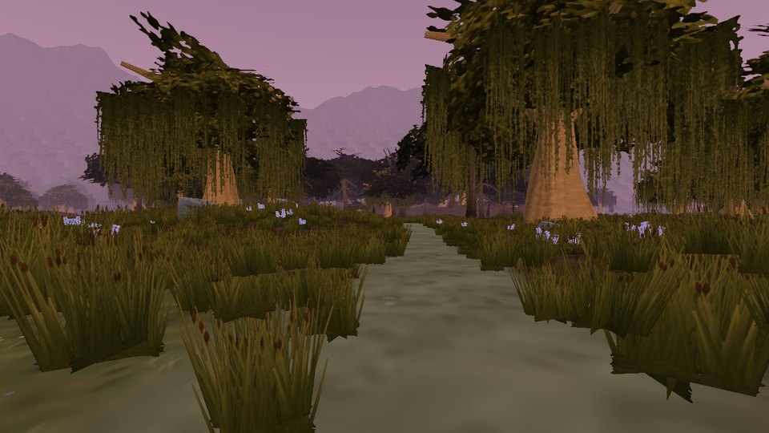
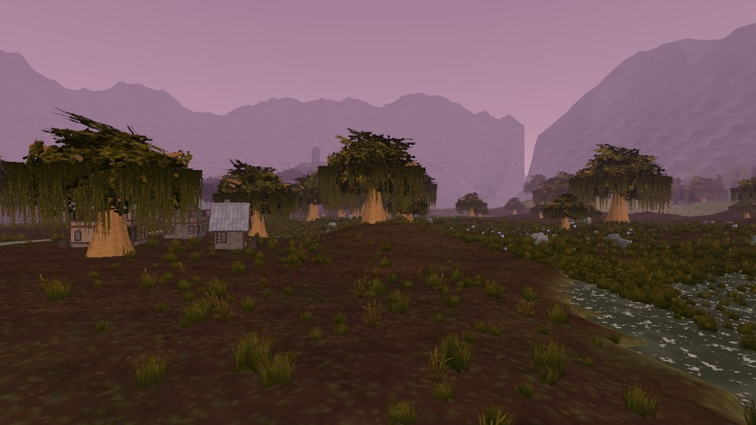

# Fallowmere: world bible

Machine-readable twin: `assets/world/layout.json` (schema `src/World/WorldLayout.cs`, checked with `tools/validate_layout.py`). Coordinates everywhere: metres from map centre, **X east, Z south** (Godot -Z = north), Y = height. Every number below is the layout's; real heights wander a few metres with the base noise and the marsh floor noise, so site heights are pinned with `flats`. The three JPEGs in `references/visual/wow-classic/` (dawn willows under a pale cliff with a lit keep; a purple dusk with a giant dark tree over a channel; a starlit road through tall reeds) are the frames the zone is tuned against.

## 1. Identity
Fallowmere is an upland vale closed on every side by grey fells whose lower slopes are olive and whose upper walls go pale pink-grey into a lavender dusk. A generation ago it was a lake country with a lordship; now the lordship has ended and the Mere has spread across the whole floor of the vale. What was one long lake is a bog: a single sheet of still water at 4.0 m broken into named pools, dark channels and low peat hummocks, with weeping moss trees standing in the shallows and tall reeds crowding every edge. The lord's hall on Harrowfold Head is a roofless ruin with bog oaks grown through it; the lord's bridge fell and the villagers laid a boardwalk beside the stubs. Thistlebury, on the one dry shelf of the south-west shore, became a dock settlement: a timber Hythe runs out from the church terrace over the water with braziers at its end. Two lights burn in the vale after sundown. One is the Candle, the tower on the bald dome the whole road points to. The other is Greywatch, a lit keep with rows of yellow windows on a ledge of the east rim wall, reached only by a stair nobody in the village has climbed. The sun sits 10 degrees above the west rim and casts no shadows; a violet ambient and a pink horizon light everything, and fog takes the far shore within a few hundred metres. The story is told through restraint: one road, one drowned lake, one village on boardwalks, one dark wood, two lit towers, a pale wall to the north that nobody goes to, and a fogged gorge to the south-east where road and river leave together.

**Three acts of the walk:** the way in (spawn, the sedge meadow, the mill on the rise, the saddle reveal of the drowned Mere) → the drowned shore (the village and the Hythe, the reed road, the causeway over the channel, the dark wood and the stones) → the heights (the coil up Candlehill, the look-back into the sun, and the Keep Stair up to the second light).

## 2. Map overview (1024 × 1024 m, one char ≈ 20 × 40 m)
```
 x: -500        -300        -100         +100        +300        +500
    ^^^^^^^^^^^^^^^^^^^^  HOARFELLS (pale wall, N edge 250 m) ^^^^^^^^^^^^   z -500
    ^^^^^^^^^^^^^^^^^^^^^^^^^^^  ~ spring 34 m  ^^^^^^^^^^^^^^^^^^^^^^^^
    ^^^^^ Westfell ^^^^^ pines  pines  ~Beck~  pines  Eastfell pines  ^^^   z -400
    ^^^^^^^^   Greyhame Shoulder (41)   ~   pines   pines   pines   ^^^^^
    ^^^^^           pines  pines    D  ~ P ~   pines   moss stands  ^^^^^   z -220  D Greyhame Delve  P Sawyer's Pool
    ^^^        ~ Black Channel ~   S~ (Sawyer's Reach)   ~ East Fen ~  G ^   z -120  G Greywatch keep (ledge 30 m)
    ^           ~ ~  ~~~~~~~~ THE MERE (sheet 4 m) ~~~~~~~   ~ Dawn Pool ~ ^
    ^   Gap Meadow       ~ ~ ~~~~~~~~  L  ~~~~~~~~  ~ ~   moss  ~   ~ ~  ^   z  -40  L Ladyholm islet
    ^ G o  road ~~~  M crest  cH ~~~~~~~~~~~~~~~~ HH ~ ~   ~   ~   ~ ~   ^   z  +20  G Gap  o Hollow Oak  M Mill  c church  H Hythe  HH Harrowfold
    ^==road====> Hob's Rise ==T== = = road = = + =R=(=)=o= W ## . C .    ^   z  +90  T Thistlebury  + Thistle Cross  R Road Oak  (=) Fallen Span
    ^            ~ Sundown ~    |  ~ Night ~  ~ Span ~ ##o*## . coil .  ^^   z +160  W Hollin Wood  * Nine Sisters  o bog oaks
    ^^      Shepherd's Bank     |  Thistle Moor  ~ Mosshide ~ Bluegill ~ Candlehill ^^   z +220  C the Candle
    ^^^              ~ Rook Pool ~        R (Rook Fold)    ~   . . ^^^   z +300
    ^^^^^^   Southfell pines    |                        ~~ Throat ~ road ^^^   z +380
    ^^^^^^^^^^^^^^^^^^^^^^^^^^^^^^^^^^^^^^^^^^^^^^^^^^^ gorge ~~exit ^^^   z +500
```
Rim foot ≈ 360 m from centre (squircle); rim crest heights N 250 / E 170 / S 160 / W 175 (+ Hoarfells mass), roughness 0.22, ramp power 2.0 (a short apron, then near-sheer walls). The "snow" layer is repurposed: snow line 120 m, blend 50 m, tinted `tintSnow` #B8A6AE, so every wall above about 120 m turns the pale pink-grey of the reference cliffs and is fully pale above ~170 m; below that the walls are the darker violet-grey rock tile. Trees stop at 60 m (pines at 95 m), so the walls stay bare.

## 3. Geography (numbers)
**Base** 5 m, chunky (noise ≥ 60 m wavelength, a few metres). **Rim** starts at 360 m, two automatic terrace bands on slopes > 26 degrees (suppressed on the bog floor, where hummock flanks must read as peat, not strata).

| Hill | Centre | r | h (summit) | Shape / role |
|---|---|---|---|---|
| Hoarfells | (-40,-560) | 340 | +55 (N rim → ~250-300) | dome; the north wall, river spring on its skirt |
| Greyhame Shoulder | (-170,-300) | 140 | 36 (41) | dome; pine shoulder, mine at its SE foot |
| Hob's Rise | (-225,50) | 115 | 18 (23, flat 24) | dome; **hides the Mere from spawn**, windmill on the crest |
| Harrowfold Head | (165,20) | 55 | 12 (17; flat cuts the top to 11) | low knoll on the SE shore, 7 m above the sheet; the ruined hall on top |
| Candlehill | (300,150) | 130 | 50 (55, flat 56) | bald dome; the coil road and the Candle |
| Rook Knoll | (90,300) | 110 | 9 (14) | low sheep knoll; hides the gorge mouth from the water |

**Basins:** Pilgrim's Gap notch (-512,125) r 125, depth 90 → notch floor ~9 m at spawn rising into fog between walls ~70 m high. The Throat notch (400,470) r 140, depth 80 → gorge walls ramp up from the river from mouth to edge.
**Ridge:** Shepherd's Bank (-200,200)→(-90,255)→(20,310), width 55, +12: separates the village from Thistle Moor.
**Flats (levelled sites):** Gap apron (-432,122) r 12 → 9.5; Hob's Mill (-225,50) r 18 → 24; Thistlebury (-105,75) r 45 → 7.5; church terrace (-60,15) r 18 → 7.5 (a promontory into the water); Ladyholm (40,-50) r 10 → 6.5; Sawyer's Reach (-38,-160) r 10 → 9; Delve apron (-120,-215) r 13 → 13.5; Harrowfold Hall (165,20) r 20 → 11; Nine Sisters clearing (215,160) r 30 → 14; the Candle (300,150) r 18 → 56; Rook Fold (90,300) r 24 → 14.5; Greywatch ledge (445,-30) r 36 → 30.

**The Mere (drowned):** the `marsh` block. Disc centre (0,20), radius 330, **water level 4.0**. Inside the disc the ground is pulled toward a floor at 4.9 m (`floorAbove` 0.9) with ±1.5 m of broad noise (48 m wavelength) so the sheet breaks into random shallow pools; the pull is 0.85 strong, fades out between 70 % and 100 % of the radius, and only takes ground that is already low (hills and rim keep their height). **Hummocks:** a 36 m grid, jittered, 60 % coverage, radius 9-24 m, height 1.2-3.4 m, elliptical, flat-topped with a small rim step so the sheet lapping them reads as a cut peat bank; none under roads, on site clearings or on ground more than 5 m above the sheet. **The old lake bowl** is still authored: centre (25,-35), radii 100 × 85 m, water level 4.0, depth 7 (bed -3 m); it is the deep heart of the bog, and its own mesh is skipped because the sheet is at the same level. **Pools** (bed depth below the sheet at centre; banks ease down over the outer 25 %):

| Pool | Centre | Radii | Depth | Where |
|---|---|---|---|---|
| Sundown Pool | (-150,165) | 48 × 30 | 1.6 | south of the village, under Shepherd's Bank |
| Bluegill Pool | (130,215) | 40 × 34 | 1.5 | between Hollin Wood and Rook Knoll |
| Black Channel (west) | (-230,-70) | 55 × 26 | 1.4 | the dark water north of Hob's Rise |
| Black Channel (east) | (-150,-120) | 60 × 24 | 1.4 | continues toward Sawyer's Path |
| Mosshide Pool | (60,210) | 30 × 42 | 1.3 | Thistle Moor's east edge |
| Sawyer's Pool | (-20,-260) | 34 × 26 | 1.4 | beside the upper Fallow below the Delve |
| Span Pool | (100,120) | 30 × 22 | 1.5 | south-west of the Fallen Span |
| Rook Pool | (10,300) | 44 × 30 | 1.4 | the moor's southern hollow |
| Dawn Pool | (300,-82) | 40 × 28 | 1.2 | the East Fen, under Greywatch |
| Night Pool | (28,122) | 30 × 18 | 1.0 | beside the Rook Track |
| Channel Pool | (160,100) | 25 × 18 | 1.0 | the channel at the Span's east bank |

Water depth is recomputed from the final heights after roads and flats (step 6b of `TerrainBuilder`): everything inside the disc below 4.0 m is wet, anything a road or flat lifted above it is dry. The sheet mesh (`WaterBuilder`) is a grid of 12 m quads clipped to the disc, dropped where every corner sits 1.5 m or more above the water; it is murky and near-opaque (bed never shows), carries pale painted glints, and does not flow. Rivers keep a 0.6 m/s drift.

**Rivers (water level, downhill, through the bog):**
- Fallow Beck, the Whitestep cascade: (-75,-405) 34 → (-48,-290) 12, width 5 (white water between pines).
- The Fallow (upper): (-48,-290) 12 → (5,-122) 4, width 7, past Sawyer's Reach and Sawyer's Pool into the north shore.
- The Fallow (lower): leaves the sheet at (100,25) 4 → Fallen Span (140,80) → (175,150) → (215,235) → gorge mouth (255,320) -1 → (310,400) → (380,470) → edge (440,512) -6. Width 10; it is the one moving channel through the bog, wraps Candlehill's west and south foot and bends twice in the Throat so the exit is never seen.

**Roads (grey-green painted track, flattened, soft 2 m edge). Inside the marsh disc every road is clamped to at least 0.6 m above the sheet: causeways, never fords.**
- *Fallow Road* (main, 4 m): Pilgrim's Stair (-472,135) → spawn (-432,122) → Gap Meadow (-385..-326, 99-116) → swings **north round Hob's Rise** (-330,66) (-316,34) (-270,-4) (-225,2) → crest beside the mill (-205,21) (-199,35) → saddle bend (-184,57) → (-181,87) (-187,116) (-160,110) → Thistlebury (-140,96) (-105,80) (-65,72) → shore road (-20,84) → Thistle Cross (40,92) → (90,92) → Fallen Span causeway (140,80) → wood (182,98) (215,78) (244.9,61.8) → **Candlehill coil** clockwise (294.7,61.2) (332.3,77.9) (358.8,113.8) (358.3,159.2) (327.9,190.3) (288.9,187.4) (276.3,146.2) → the Candle (297.4,138.3). Only the two Stair legs behind the spawn are steep, into fog, never walked.
- *Throat Road* (main, 4 m): forks from the coil at (332.3,77.9) → unwinds down the E flank (368,92) (392,122) (394,165) (378,210) (352,255) (322,295) → hugs the river's NE bank (290.4,350.3) (315.9,387.4) (345.3,418.3) (377.1,450.1) (410.6,476.8) (440.9,498) → edge (452,512).
- *Keep Stair* (path, 2.5 m): leaves the Throat Road at (392,122) → (412,104) (430,80) (442,55) (447,30) (447,5) → Greywatch ledge (440,-18). The only road that climbs the rim.
- *Sawyer's Path* (2.5 m): village north end (-95,42) → west shore (-104,-15) (-92,-78) (-66,-128) → Sawyer's Reach (-52,-150) → (-60,-176) (-84,-196) (-108,-208) → Greyhame Delve (-120,-215).
- *Rook Track* (2.5 m): Thistle Cross (40,92) → (48,140) (62,195.7) (92.5,222) (122.6,252.1) (130.3,285.1) → Rook Fold (109,312.9), past Night Pool and Mosshide.
- *Sisters' Spur* (2.5 m): (222,84) → (213,108) → (221,132) → (216,143). *Hall Path* (2.5 m): (160,88) → (165,78) (186,57.5) (197.8,24) (171.7,-2) → the hall (152.1,18.2), one counter-clockwise turn round Harrowfold Head.

## 4. Landmarks and settlements
Eighteen sites: nine landmarks, the village, the farm, the fold, and six groves that place hero trees. Kit = Quaternius Medieval Village (2 m cottage modules, brick wall modules for ruins and the keep, dark plank floor tiles for boardwalks), KayKit landmarks (church, windmill, well, lumbermill, mine, tower; all tinted weathered grey #9C9698, the keep #9A9298), Quaternius Nature (pines, dead trees, rocks, ferns, flowers), and three procedural models built in `ProceduralFoliage.cs`: **MossTree_1-3** (pale tapered trunk 2-2.5 m thick, 16.5-19.5 m tall, a broad lumpy umbrella 16-19 m across at 78 % of the height, moss curtains hanging in 5-7 bunches to about half height), **BogOak_1-3** (a kit dead-tree trunk scaled to 22-24 m under two tiers of dark leaf cards, bare twigs poking out above the crown) and **Reeds_1-3** (2-3 crossed painted cards, 1.5-2.0 m). Standing stones under 2.5 m are squat boulders; taller ones are menhirs.

1. **Pilgrim's Gap** (spawn): (-440,124), h ≈ 10. Three leaning waystones 3.4-3.6 m in a half ring, three RockPath_Square_Thin paving slabs, one crate, two boulders (1.6, 1.4 m). Behind: the Stair rising into fog between the notch walls. *Silhouette:* three dark fingers against pale notch walls. *Purpose:* the way in; from here the only things to look at are the road and the sails.
2. **The Hollow Oak**: (-372,142). One BogOak_3 (tint #3A4A2E) in a sedge clearing the road bends round, a 2-span fence stub, a crate and a boulder as a wayside shrine. *Purpose:* the first giant dark tree, 70 m from spawn.
3. **Hob's Mill** (farm): (-225,50) on the crest, h 24. KayKit windmill ×10 facing 250 degrees (sails on the skyline, turning), one 4 × 4 stone cottage with a chimney at (-212,59), a 4-point fence along the road, a wagon, two crates, two boulders. *Silhouette:* cross of sails on a bald rise, 215 m from spawn. *Purpose:* first destination; the rise that hides the water.
4. **Thistlebury** (village): (-105,75), clearing r 30 (the pieces reach further; the boardwalks claim their own strips), flat 7.5 (3.5 m above the sheet). Church ×8 at (-60,15) on the shore promontory, facing east over the water; well at (-103,68) ringed by six RockPath_Round_Thin; six chimneyed cottages: timber 6 × 8 two-storey (-82,92), stone 4 × 8 one-storey (-128,96), timber 4 × 8 two-storey (-130,55), stone 4 × 4 (-88,110), stone 6 × 8 two-storey (-62,98), stone 4 × 4 (-80,45); three fence lines (the approach (-162,97)→(-120,88), a yard (-142,48)→(-124,66), the east edge (-54,101)→(-30,118)); two wagons, four crates (two at the Hythe root); three moss trees (#96A058) at (-47,111), (-117,59), (-95,97). **The Hythe:** a timber boardwalk 30 × 2.4 m running east from the church terrace along z 15 (x -59 to -29), deck 1.2 m above the sheet on posts down to the bed, a 1.5 m brazier at its end (-30,15); a second boardwalk 18 × 2.0 m running north-south at (-65,3) with its own brazier at (-65,-5). No tavern, smithy, fields or orchard: the fields are under water. All roofs #4E5A60. *Silhouette:* church tower on the promontory, two braziers on the water, cottages behind. *Purpose:* the hub, and the only lights below the towers.
5. **Ladyholm**: islet (40,-50), r 10, top 6.5 (2.5 m above the sheet); one MossTree_3 ×1.1 (#96A058) and four waterline boulders. *Silhouette:* a single weeping tree standing in the water, reflected. *Purpose:* focal point of every view over the Mere.
6. **Thistle Cross**: (40,92). A 2.6 m waystone and two paving slabs where the road east, the road west and the Rook Track meet, with the mill, the Candle and the wood all in view.
7. **Road Oak**: (58,106). One BogOak_2 (#2E3A26) beside the shore road and a MossTree_1 (#96A058) at (30,70). *Purpose:* the dark crown over the reed road in the `road` shot.
8. **The Fallen Span**: (140,80) where the road crosses the lower Fallow (site rotated -36 degrees so local x runs across the channel). Two broken abutments (4 × 3.2 m) and a mid-channel pier (2.5 × 2.4 m) 8 m downstream of the road line, a fallen arch section (5 × 1.1 m) in the shallows, two boulders, a fence stub, and the **boardwalk**: 26 × 2.0 m along the road line, deck 1.2 m above the sheet, which with the causeway clamp makes the crossing. *Silhouette:* broken stubs mirrored in slow water, a boardwalk beside them, the black wall of Hollin Wood behind. *Purpose:* threshold between the open bog and the dark wood; the story's first line.
9. **Channel Oak**: (152,80) on the Span's east bank. One BogOak_1 (#2E3A26) and a MossTree_2 (#96A058) at (128,96). *Purpose:* the giant silhouette against the low sun in the `giant` shot, with Channel Pool (160,100) and the Fallow at its feet.
10. **The Warden**: (226,90). One BogOak_2 (#3A4A2E) leaning over the road at the Sisters' fork.
11. **The Nine Sisters**: (215,160), clearing r 30 at 14 m inside Hollin Wood, 63 m down the worn spur. Eight standing stones 4.2-4.5 m on an 11 m ring plus one fallen (4.4 m), a RockPath disc ×2.5 at the centre, four moss trees (#96A058) at r 25. *Silhouette:* nine verticals under weeping crowns. *Purpose:* the wood's secret; dread turns to wonder.
12. **Harrowfold Hall**: (165,20) on the Head, flat 11, rotated 15 degrees. Five roofless brick wall teeth (10 × 7.2, 6 × 3.9, 14 × 5.2, 14 × 7.8, 6 × 3.2 m) with end caps and rubble, one surviving corner tower (KayKit tower ×7), three **bog oaks** (#3A4A2E) grown through the walls, two dead trees ×1.35 (tint #4E5E34) on the west lip, three RockPath floor remnants, two boulders. *Silhouette:* tower stub and wall teeth under three dark twisted crowns on a low knoll barely above the water, seen across the Mere from the Hythe and the saddle. *Purpose:* the zone icon; the lordship that ended.
13. **The Candle**: (300,150), summit 56. KayKit tower ×9 (~17 m) with an **emissive brazier on top at 20.2 m**, four 12 m parapet walls 1.4 m high on a 13 m square, six boulders 1.6-2.0 m on a 13 m ring, one crate. *Silhouette:* a single round finger on a bald dome, the pale coil wrapped beneath it. *Purpose:* the road's end and the look-back into the sun.
14. **Rook Fold** (camp): (90,300), flat 23.5, rotated 20 degrees. Dry-stone fold of four 1 m walls (14, 14, 14, 10 m), one MossTree_2 (#96A058), a 36 m fence line down the north slope, three boulders. *Purpose:* the moor look-back over Rook Pool and Mosshide toward the village lights.
15. **Sawyer's Reach**: (-36,-162) on the west bank, flat 9. KayKit lumbermill ×8 with its wheel toward the river (east), a wagon, four crates as a log stack, a 3-point fence, the first two pines ×1.2. 130 m upstream the Whitestep cascade falls through the pines. *Purpose:* end of the inhabited world going north.
16. **Greyhame Delve**: (-120,-215). KayKit mine ×8 facing SE at the shoulder's foot, a **still-loaded wagon** (three crates), a 3-point fence, one dead tree ×0.6, three boulders; nowhere further to go.
17. **Greywatch**: (445,-30), clearing r 40, on a flat ledge r 36 cut at 30 m into the east rim wall. KayKit tower ×13 (~25 m) at (451,-34) with a **brazier on its top at 27.5 m**; three **intact** brick walls 9.4 m high (a 10 m west wall at x 438, 14 m north and south walls at z -35 and -25) stacked from the kit's module; four **window rows** of emissive yellow cards (#F2C465) with a warm light every third window: on the west face five windows at 5.0 m (1.9 m apart) and four at 7.8 m (2.2 m apart), on the south face five at 5.0 m (2.4 m) and four at 7.8 m (2.8 m); a ground brazier (1.6 m) in the yard, one boulder, one crate, one dead tree ×0.9. The ledge biome is bare rock. *Silhouette:* a lit wall and tower stuck to a pale cliff, read from the Dawn Stand across Dawn Pool. *Purpose:* the second light; the keep that still watches a vale with no lord.
18. **Dawn Stand**: (330,-90), clearing r 38. MossTree_3 ×1.1 at (314,-66), MossTree_1 at (352,-120), BogOak_3 (#2E3A26) at (280,-50): the willows that frame the `dawn_keep` shot, with reeds in Dawn Pool between them and the keep.

Hero-tree ledger (hard rule): hand-placed bog oaks 8 (Hollow Oak, Road Oak, Channel Oak, Warden, Dawn Stand 1 each, Harrowfold 3); hand-placed moss trees 13 (Thistlebury 3, Ladyholm 1, Sisters 4, Rook Fold 1, Road Oak 1, Channel Oak 1, Dawn Stand 2); dead trees only at Harrowfold (2), the Delve (1), Greywatch (1) and in the biomes that mean it. Lights: five braziers (the Candle, Greywatch tower and yard, the two Hythe braziers) and 18 windows, all at Greywatch.

## 5. Foliage plan (biomes are soft-edged circles; higher priority wins)
Calibration: tree spacing = 5 m / sqrt(density), tightened inside stands; the validator's rough estimate for this layout is **≈ 1,900 trees** (cap 3,500) and up to 45,000 undergrowth instances. Bog rules in `FoliagePlacer`: inside the marsh disc a stand's chance of surviving scales from 25 % on ground within 0.8 m of the sheet to 100 % at 2.2 m above it, so **stands gather on hummock crowns and islands** and the open sheet stays treeless; moss trees and bog oaks are waders (may stand in up to 0.5 m of water), every other tree keeps 3 m off the water; **reeds** are placed at full density within 7 m of water and a quarter elsewhere, may stand in 0.6 m of water, and stay visible to 170 m; trees stop at 60 m altitude (pines 95 m), undergrowth at 50 m; trees keep 4.5 m plus their scale off road centrelines, undergrowth 2.8 m, reeds 2.4 m.

| Region (centre, r, prio) | Density / clump | Trees | Undergrowth (density) | Ground | Leaf tint |
|---|---|---|---|---|---|
| **Mere Bog** (0,20) 330, p2 | 0.09 / 0.75 | MossTree_1-3, BogOak_1 (w 0.1), DeadTree_3 (w 0.15) | Reeds_1/2 0.55, Reeds_3 0.35, Grass_Wispy_Tall 0.1 ×1.3 straw #D8C47A, Rock_Medium_2 0.008, Flower_4_Group 0.03 **bog-blue #6F7FD0** | grass (peat and sedge by the marsh rule) | #96A058 |
| North Shore (-30,-190) 120, p4 | 0.16 / 0.55 | MossTree_1-3, BogOak_1 (w 0.12), DeadTree_3 (w 0.2) | Reeds_1/2 0.55, Reeds_3 0.35, wispy tall 0.1, Pebble_Round_1 0.03 | grass | #96A058 |
| East Fen (330,-60) 150, p3 | 0.10 / 0.85 | MossTree_2 ×1.1, MossTree_3 ×1.15, BogOak_2 (w 0.1) | Reeds_1/2 0.5, wispy tall 0.1 ×1.3 straw | grass | #96A058 |
| Thistle Moor (-70,250) 210, p2 | 0.05 / 0.9 | MossTree_2, MossTree_3 (w 0.7), DeadTree_1 ×0.9 (w 0.3) | Reeds_1 0.35, Reeds_3 0.25, wispy tall 0.15, Rock_Medium_3 0.01 | **meadow** (sedge) | #96A058 |
| Gap Meadow (-385,130) 95, p3 | 0.07 / 0.85 | MossTree_3, MossTree_1 ×0.95 (w 0.7), DeadTree_1 ×0.8 (w 0.3) | Reeds_1 0.3, Grass_Common_Tall 0.1, Flower_3_Group 0.05, Bush_Common_Flowers 0.01 | **meadow** | #96A058 |
| Hob's Rise (-225,50) 115, p3 | 0.04 / 0.9 | MossTree_2, DeadTree_1 ×0.9 (w 0.6) | wispy short 0.2, wispy tall 0.1, Reeds_2 0.15 | grass | #8A9452 |
| **Hollin Wood** (205,100) 125, p5 | **0.32 / 0.2** | BogOak_1-3, MossTree_2 (w 0.7), DeadTree_5 ×1.1 (w 0.4) | Fern_1 0.4 (#6E7E4A), Mushroom_Common 0.05, Reeds_2 0.2 (#96A058) | **forestFloor** (peat) | #3A4A2E |
| Harrowfold Head (165,20) 62, p6 | 0.08 / 0.5 | BogOak_2, DeadTree_5 ×0.9 (w 0.6) | Rock_Medium_1 0.012, wispy tall 0.15, Reeds_3 0.2 (all #96A058) | grass | #3A4A2E |
| Candlehill Flank (300,150) 135, p4 | 0.18 / 0.7 | Pine_1/3/5 ×1.15, MossTree_1 ×0.95 (w 0.6), DeadTree_1 ×0.9 (w 0.4) | wispy short 0.12, Rock_Medium_2 0.02, Reeds_1 0.15 | grass | #3E5240 |
| Candlehill Top (300,150) 72, p7 | 0 | none (bald) | Grass_Wispy_Tall 0.18, Rock_Medium_1 0.02 | grass | #8A9452 |
| Greywatch Ledge (445,-30) 42, p7 | 0 | none | Rock_Medium_1 0.02 | **rock** | #2F4436 |
| Hoarfell Pines (-40,-430) 240, p3 | 0.30 / 0.5 | Pine_1-5 ×1.2, DeadTree_1 ×0.8 (w 0.4), DeadTree_3 ×0.8 (w 0.3) | Rock_Medium_1/3 0.02, wispy short 0.1 | grass (pale wall above 120 m) | #2F4436 |
| Greyhame Pines (-190,-300) 160, p3 | 0.30 / 0.5 | pines + dead as above | Rock_Medium_2 0.03, wispy short 0.1 | grass | #2F4436 |
| Eastfell Pines (300,-320) 210, p3 | 0.22 / 0.6 | pines + dead + MossTree_1 ×0.9 (w 0.5) | Rock_Medium_1 0.02, wispy short 0.1 | grass | #2F4436 |
| The Throat (390,440) 180, p5 | 0.08 / 0.6 | DeadTree_1/3 ×1.1, DeadTree_5 ×1.1 (w 0.6), Pine_2/4 ×1.3 (w 0.8) | Rock_Medium_1/2/3 0.02 each, Pebble_Square_1 0.04 | **rock** | #2F4436 |
| Southfell (0,440) 220 / Westfell (-440,-130) 180 / Eastfell (470,-160) 150, p2 | 0.15 / 0.7 | pines ×1.2 + dead | Rock_Medium_2 0.02, wispy short 0.1 | grass | #2F4436 |

Ground rules (step 7 of `TerrainBuilder`): inside the marsh disc (full strength out to 78 % of the radius, gone at 100 %) **peat** (the forest-floor tile) covers everything within about 1.9 m of the sheet and fades out by ~4.5 m above it; a **sedge band** (the meadow tile) rings the water from just below the waterline to ~1.2 m above it; plain **turf** survives only on hummock crowns and the higher ground around the bog; slope rock is suppressed below sheet + 6 m so hummock flanks never band; banks darken 12 % within a metre of the water (damp peat lip); river and pool beds read as peat. Clumps with glades everywhere except Hollin Wood (one uniform dark wood by design); bare crests on Hob's Rise and Candlehill; the Greywatch ledge bare; ferns and mushrooms only in Hollin Wood; cream and straw flowers in the Gap Meadow, bog-blue flowers only on the Mere Bog's banks. Prop types per area ≤ 4: meadow = fence · flowers · crate · oak; village = fence · crate · wagon · well (plus the boardwalks and braziers); bog = reeds · boulder · moss tree · dead tree; wood = fern · mushroom · dead tree · stones; Throat = dead tree · boulder; keep = wall · window · brazier · crate.

## 6. Palette and lighting
One dusk palette: olive and straw greens, red-brown peat, grey-green water and track, and a lavender-pink sky, fog and cliff family; one warm accent (the braziers and the keep's windows) and one cold accent (the bog-blue flowers). Nothing is pure white or black.

| Key | Hex | Key | Hex |
|---|---|---|---|
| grass (olive turf) | #5C6A36 | meadow (sedge) | #7E803E |
| forestFloor (peat) | #463428 | road (bog track) | #7A7E62 |
| rock | #9A8E96 | snow (pale wall layer) | #D8DFE6 |
| water | #6A7060 | waterDeep | #46503F |
| waterShore | #7E8470 | waterGlint | #B9BCA6 |
| waterSky | #A8A2A4 | skyTop | #726080 |
| skyHorizon | #CFA4B8 | fog | #A684A4 |
| ambient | #9C94A4 | shadowTint | #5A4E7A |
| cloudLight | #D4B2C8 | cloudShadow | #8E7A9E |
| sunWarm | #DCA8B0 | tintSnow (pale wall) | #B8A6AE |
| roofTile | #4E5A60 | timber | #6A4E36 |
| plaster | #B8AEA4 | stone | #7E7A78 |
| leafWarm (moss trees) | #96A058 | leafCool | #56663A |
| pine | #2F4436 | | |

Site tints outside the palette: bog oaks #3A4A2E and #2E3A26, Harrowfold's dead trees #4E5E34, KayKit landmarks #9C9698 (Greywatch #9A9298), brazier glow #F0A050, windows #F2C465, boardwalk planks #6E5A44 on posts #3E3024, ruin stone #5E5C5A.

**Sun** (`sun` block): azimuth **262** (light from the west, just south of due west, so the walk east is lit from behind and the Candle look-back is into it), elevation **10**, colour #ECB4A4, energy 0.9, **shadowOpacity 0.0** (the shadow map is disabled; the dusk is shadowless, as in the references).

**Fog and mood** (`fog` block): depth fog **30 → 620 m**, curve 0.9 (arrives early, saturates late), density ceiling 0.9 (the far rim keeps a tenth of its own shading); **height fog** enabled, level 6.0 (applied as a band from 4.0 m, exactly the sheet) with density 0.1, so the water carries a visible haze; ambientEnergy **1.35** (ambient-dominant, colour `ambient`); saturation 0.92, contrast 1.0; **cloudOpacity 0.0** (a clear gradient sky; the cloud pass is skipped), cloudCoverage 0.7; horizonWarmth 0.1; **skyCurve 0.4** (most of the dome stays in the horizon tone); stars 0.0; sunScatter 0.1; sun disc 3.5 degrees at energy 0.8, glow power 50 / strength 0.8, halo power 14 / strength 0.2. Fog colour and horizon are painted on screen exactly (the atmosphere pre-inverts the filmic tonemapper); the sky shader blends the lowest 0.18 of the dome three quarters of the way to the fog colour. No bloom, SSAO or SSR. No per-area fog volume: the dark wood is made with bog-oak canopy, the peat tile and the cooler leaf tint.

**Ground tiles** (`tools/paint_textures.py`, 512 px, seamless on a torus, lit from the top-left): grass = olive turf #5C6A36 / #7C8842 / #3F4D2A / #7E7F44; meadow = sedge #7E803E / straw #A89C58 / #596038 / #6E7A3C with cream, straw and bog-blue flower specks; forest_floor = peat #463428 with litter #5E4A36 / #72603E, moss cushions #55602F, root shadows #2C221C; dirt_road = trodden grey-green mud #7A7E62 / worn #8F9272 / #5E6248 with grey pebbles; rock = violet-grey strata #8E8288 / #746A70 / #564D54 / cracks #3A3238 with lit lips #A0949A, kept a step below the fog colour so the lower walls read as darker silhouettes under the pale upper wall; snow = near-white drifts, tinted mauve in engine. **Foliage cards** (`tools/paint_foliage.py`): moss_curtain olive → yellow-green → straw (#4C5A2A, #6E7C38, #9AA64C, #C6BD74); leaf_clump #3F4E26 → #BDB868; reeds #46532A root to #CBBF6E tips with a few cattail heads; bark_pale sand-grey #A89A84 / #8C7E6A / #6A5E4E (the bog oak multiplies it down to a near-silhouette brown-grey).

**Night variant** (`assets/world/palette_night.json`, the third reference frame): a palette/sun/fog overlay merged over the layout with `--palette=` (`EXTRA="--palette=res://assets/world/palette_night.json" OUT=screenshots/night tools/screenshot.sh road`). Deep teal sky (#062030 → #1E5A76), fog #17465A, ambient #3C6270, moonlight from azimuth 120 at 35 degrees (#9CC2CC, energy 0.45), stars 0.9, the road tinted the palest ground value (#C4D4C8). It is a mood overlay, not a layout: it has no sites or shots of its own.

## 7. Hero shots (all in `shots`; eye = ground + offset)
The first three mirror the three reference frames.
1. **dawn_keep**: cam (296,-100) +1.7 → (420,-58) +14, FOV 56. The dawn-willows frame: the east wall filling the top of the frame and going pale, Greywatch's lit windows and tower on their ledge upper right, the Dawn Stand moss trees with hanging curtains at the frame edges, reeds standing in Dawn Pool in the foreground.
2. **giant**: cam (200,100) +1.7 → (100,88) +5, FOV 56. The purple-dusk frame: looking west into the low sun; the Channel Oak's black twisted crown against the glow, the Fallen Span's channel and Channel Pool as a pale glinting sheet below it, moss trees receding into pink fog.
3. **road**: cam (-10,100) +1.5 → (96,80) +2.5, FOV 58. The night-road frame (and the night overlay's test shot): the pale track east from the shore road through tall reeds, bog-blue flowers along the verge, the Road Oak's dark crown over the way, Thistle Cross and moss stands beyond.
4. **willows**: cam (-118,-98) +1.7 → (-30,-200) +9, FOV 58. Up the west shore through the North Shore moss stands over Black Channel toward Sawyer's Reach and the pines.
5. **hythe**: cam (-24,44) +1.7 → (-62,8) +5, FOV 56. The village's waterfront: the Hythe on its posts, the brazier at its end, the church on the terrace, water on three sides.
6. **causeway**: cam (167,101) +2.0 → (126,64) +2, FOV 56. The Fallen Span from the east bank: boardwalk, abutment stubs and the clamped road riding above the sheet, looking back toward the village.
7. **reveal** (saddle): cam (-178,52) +3 → (40,10) +4, FOV 56. The road drops left to the church promontory and the Hythe; the drowned Mere as one sheet with moss stands on their hummocks and Ladyholm's tree; Harrowfold's bog oaks on their low knoll centre-right; the Candle a pale finger beyond; the east wall going pale into the fog.
8. **village**: cam (-122,92) +1.7 → (-96,66) +3, FOV 55. Well and square centre, cottages right and left, church tower over the roofs, water beyond.
9. **hall**: cam (-44,8) +2.4 → (165,20) +10, FOV 58. From the church terrace across the water: reeds dark in the foreground, the sheet carrying the pink of the sky, wall teeth under three dark crowns at the focal point, the Candle on its dome to the right.
10. **postcard**: cam (-86,-12) +1.7 → (-42,-200) +10, FOV 52. Up the bog from the terrace to the mill wheel at Sawyer's Reach, the Whitestep's line, black pines, the pale north wall.
11. **spawn**: cam (-436,131) +1.7 → (-225,50) +22, FOV 62. The road leaves bottom centre, bends through the sedge meadow past the Hollow Oak and climbs round the Rise to the sails on the skyline; waystones frame the left edge; the water does not exist yet.
12. **candle** (establishing wide): cam (292,153) +15 (parapet) → (-20,0) +6, FOV 62. Into the sun: the Mere a sheet of light with Ladyholm black on it, Thistlebury's braziers on the far shore, the sails a speck on Hob's Rise, Hollin Wood a dark pool below, the coil under the camera, the west rim gone to fog.
13. **sisters**: cam (214,149) +3.2 → (215,161) +0.5, FOV 66. The ring of stones and the fallen one under the moss trees.
14. **wood**: cam (232,92) +1.7 → (260,70) +3, FOV 62. The Warden's trunk fills the left third, ferns and mushrooms on peat, the road bending into dark bog-oak crowns with a pale gap uphill.
15. **throat**: cam (352,255) +2.5 → (330,380) +12, FOV 60. Dead trees and boulders replace reeds, the river curls into the gorge, walls close, fog swallows the bend.

## 8. The walk
**Act 1: the way in.** The wanderer spawns beside the three waystones; behind them, the Stair climbs into violet fog. Ahead the road runs east into a sedge meadow where moss trees stand with their curtains down and reeds fill the hollows, and climbs to a windmill whose sails turn on the skyline 215 m away. One destination. *Beat: a place to go.* Gap Meadow: a fence stub and a crate at the roots of the Hollow Oak, the first giant dark tree, which the road bends round; the Candle's tip far east. *Beat: first wonder.* Hob's Rise: the road swings north round the shoulder, the hill always between them and whatever lies east, then climbs to the crest beside the mill; sails loom, a stone cottage, a wagon. First look back over the meadow to the notch. *Beat: height.* The saddle: ten steps past the mill the ground falls away and the vale opens in one picture, and the vale is water: a sheet of pink light broken by dark hummocks with weeping trees on them, a church on a promontory with a boardwalk and a brazier, one tree on an islet, three dark crowns over a ruin on a low knoll across the water, a tower on a bare hill, and far to the east a lit wall stuck to a pale cliff. *Beat: the reveal; the whole remaining walk in one frame.*

**Act 2: the drowned shore.** Thistlebury: switchback descent along a fence line to the square (well, cottages, wagons); out along the Hythe to the brazier at its end, Ladyholm 90 m offshore and Harrowfold straight ahead, water on three sides. *Beat: home, on posts.* The shore road to Thistle Cross: reeds taller than the wanderer on both sides, bog-blue flowers along the verge, the Road Oak's crown overhead, water glinting through the stems; at the waystone three ways: back, the Rook Track south over the moor past Night Pool, the road east. *Beat: choice.* The Fallen Span: the lord's bridge is two stubs and a pier; the road rides a causeway and a boardwalk beside them over the one moving channel in the bog, the Channel Oak black against the sun on the far bank; beyond, a solid wall of dark crowns. *Beat: threshold.* Hollin Wood: light drops under the bog oaks, ferns brush the road, mushrooms on dead trunks, peat underfoot, the Warden leans over the way; a worn spur south, and 60 m on, nine stones in a ring under four weeping trees, one fallen. *Beat: quiet fear, then wonder.*

**Act 3: the heights.** Candlehill: the road climbs out of the trees and coils a full turn round the bald dome; the sheet reappears at every quarter turn, then the gorge and the fogged south-east. *Beat: climb.* The Candle: from the parapet, looking back west into the low sun, everything walked is in one frame, the Hythe's two sparks on the far shore; the brazier burns beside them. *Beat: payoff.* The fork: the Throat Road unwinds down the east flank, and at (392,122) the Keep Stair leaves it and climbs the rim to Greywatch: intact walls, two tiers of lit windows, a brazier on the tower, a yard with one crate and one dead tree, and nobody. From the ledge the whole bog lies below with its pools catching the last light. *Beat: the second light; the question the zone does not answer.*
Codas: Sawyer's Path north along the west shore to the wheel, the cascade and the loaded wagon at the Delve under the pale wall; the Throat Road down beside the river into the gorge, walls closing, fog to violet: the world continues.

## 9. Classic checklist → design choices
1. **Silhouette:** every landmark is one primitive (sails on a bald rise, a church tower on a promontory, one weeping tree in water, broken stubs with a boardwalk, nine verticals, wall teeth under three dark crowns, a finger on a bald dome, a lit wall on a cliff); moss trees are a flat lumpy umbrella on a pale post, bog oaks a black twisted mass; hills are six smooth domes plus a banded rim; hummocks are flat-topped domes; no terrain noise under 48 m.
2. **Palette:** olive and straw greens, red-brown peat and a lavender-pink sky/fog/cliff family; mid saturation (grading 0.92); shadows tinted #5A4E7A and in practice absent; warm light only at the braziers and windows, cold accent only in the bog-blue flowers; no pure white (the pale wall is #B8A6AE-tinted) and no pure black (bog oaks are #2E3A26 over sand bark).
3. **Value structure:** each hero shot has a dark near band (reeds, a bog-oak trunk, boardwalk posts, the parapet), a mid band (water sheet, moss stands, village) and a pale far band (rim in fog, the pale wall); the west sun behind the walker keeps the mid tones readable; only `giant` and `candle` are into the light. `tools/shot_stats.py` prints the percentiles to check it.
4. **Fog / depth:** fog = #A684A4 next to a #CFA4B8 horizon; 30-620 m with curve 0.9 gives three planes (near stand, far stand, wall); a height-fog haze sits on the sheet at 4.0 m; both notches bend so no sky-hole or map edge shows; the fog is the design, not a draw-distance patch.
5. **Road readability:** one pale grey-green ribbon from a real entry to a real tower with real destinations on every branch, clamped above the water as a causeway so it never disappears into the sheet; S-curves follow contours; fences line the approaches; the Keep Stair is the one road that climbs.
6. **Scale cues:** 1.8 m wanderer against 1.5-2 m reeds, 3.5 m waystones, 2 m fence spans, 4 m wagons, 2-2.5 m thick moss-tree trunks under 18 m umbrellas, 22-24 m bog oaks, a 17 m tower and a 25 m keep, a 10 m channel crossed on a boardwalk, 70 m notch walls, a 1 km vale.
7. **Foliage density:** stands on hummock crowns with open water between, reeds as a near-carpet only at the water's edge (the zone says so), bare crests and ledges, one dense wood by design; ~1,900 trees.
8. **Painterliness:** six procedural soft tiles (turf, sedge, peat, track, strata, pale wall), ≤ 4 blends per area, vertex hue tint (reddish peat against olive, damp banks darker, sun-facing slopes a touch lighter), painted foliage cards with the light baked in, hand-painted kit textures, no PBR maps.
9. **Lighting:** ambient-dominant (1.35), a 10 degree sun at 0.9 with shadows off, no bloom/SSAO; two emissive towers, two emissive dock braziers, window cards with a few point lights.
10. **Restraint:** nine landmarks on 1 km², ≤ 4 prop types per view, an empty moor and an empty East Fen, a bog with a single tree on an islet, 21 hero trees, dead trees only where they mean something, one keep with nobody in it.
11. **Zone identity:** Wetlands-register bog at dusk (pools, hummocks, weeping trees, reeds, boardwalks, a causeway, a lit keep on a cliff, fog as the main feature) with an Elwynn-register village core as the one cosy note and a fogged exit gorge; the quiet story of a lordship that ended and a lake that kept rising makes it Fallowmere, not a generic stylised swamp.

## 10. Renders
Hero shots are rendered with `tools/screenshot.sh` into `screenshots/<run>/` (1280 × 720, software Vulkan; `iter1` … `iter5` are the tuning passes against the references) and curated into `docs/screenshots/*.jpg` (960 × 540) with `tools/curate_screenshots.py screenshots/<run> docs/screenshots`. `tools/shot_stats.py screenshots/<run>/*.png` prints the luminance percentiles (p5/25/50/75/95), the share of pixels above 80 and below 12, and the mean saturation per shot, which is checklist item 3 as numbers. The curated set follows the layout's `shots` list: `dawn_keep`, `giant`, `road`, `willows`, `hythe`, `causeway`, `reveal`, `village`, `hall`, `postcard`, `spawn`, `candle`, `sisters`, `wood`, `throat`; regenerate it after every change to the look.

   

## 11. Build status
Implemented against this bible (all generated at startup from `assets/world/layout.json`):
- Terrain: rolling base, per-side rim heights (north 250 m) with a steep ramp, hills/ridges/basins, the **marsh floor** pulled to just above the sheet with broad noise, a field of flat-topped **hummocks**, eleven carved **pools**, the old lake bowl, river trenches, roads flattened and **clamped above the sheet as causeways**, settlement flats, banded strata on steep slopes (not on the bog floor), marsh splat rules (peat below ~2 m above the sheet, a sedge ring at the waterline, turf on crowns), damp-bank darkening, the pale-wall layer above 120 m.
- Water: one **marsh sheet** at 4.0 m as a clipped grid, plus three river ribbons; murky near-opaque bog water with painted glints; the lake mesh is skipped when it shares the sheet's level.
- Sites: cottages from the modular kit, KayKit church / windmill / well / lumbermill / mine / towers with a muted grey tint, fences, ruined walls with end caps and rubble, **intact walls** stacked to height (the keep), **window rows** (emissive cards plus point lights), **boardwalks** on posts (the Hythe, the Fallen Span), braziers (box, emissive fire, additive halo, point light), height-true standing stones and boulders, hand-placed procedural hero trees.
- Foliage: procedural **MossTree / BogOak / Reeds** meshes with painted cards (`tools/paint_foliage.py`), wader trees, hummock-crown stands, reed rings at the water, per-choice undergrowth tint and scale (straw tufts, bog-blue flowers), altitude limits that keep the walls bare.
- Atmosphere: painted gradient sky with a low sun disc and halo, no clouds, horizon-matched depth fog 30-620 m with curve and ceiling, a height-fog haze on the sheet, violet ambient at 1.35, saturation grading, shadows off; every knob lives in the layout's `sun` and `fog` blocks. The sky shader has a star-field uniform and the fog block a `stars` knob; the night mood is an overlay file (`palette_night.json`) applied with `--palette=`, and no night layout with its own sites or shots is authored.
- Wanderer: 1.8 m hooded figure with a WoW-style orbit camera; spawns at Pilgrim's Gap facing the road (yaw 100).

Not yet done (small, optional): the Throat Road towpath snap to the river bank; a pale foam tint on the Whitestep reach; `mud.png` is painted but not wired (beds read as peat); `docs/screenshots/` must be re-curated from the latest run so the README pictures show the bog.
Validator warnings expected and accepted: the Hoarfells hill centre is off-map (north rim mass); Fallow Beck ends where the upper Fallow begins (one river split for the grade kink).
